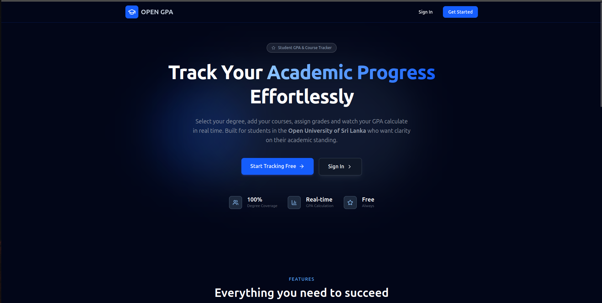
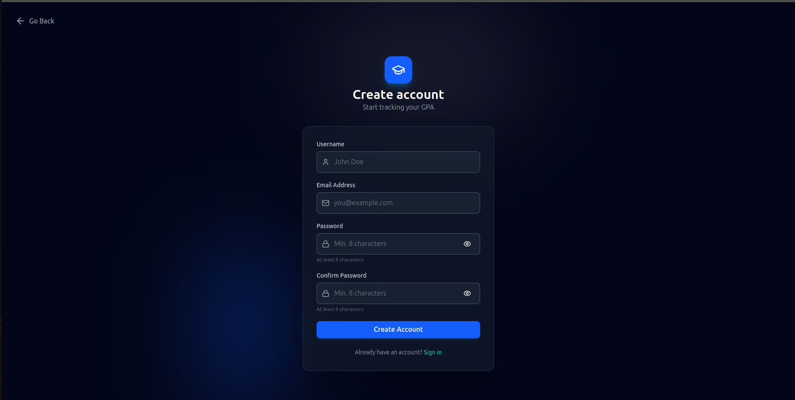
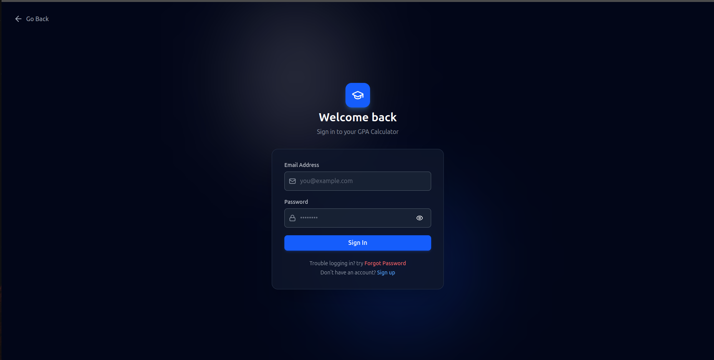
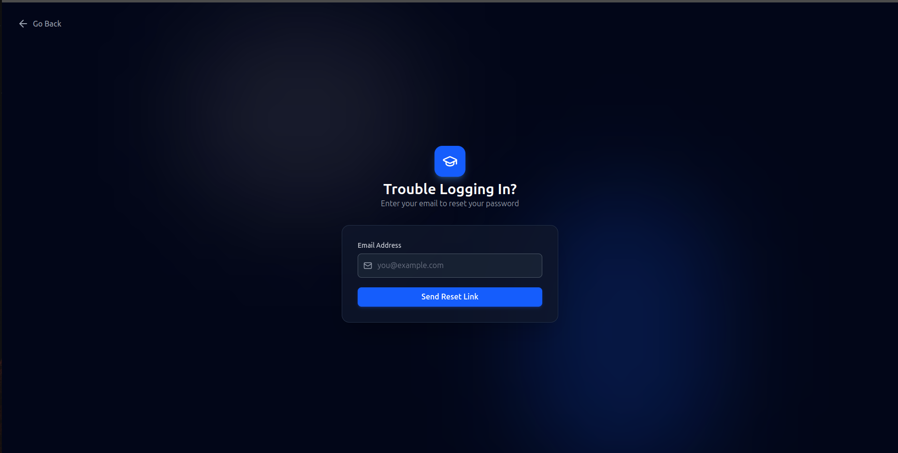
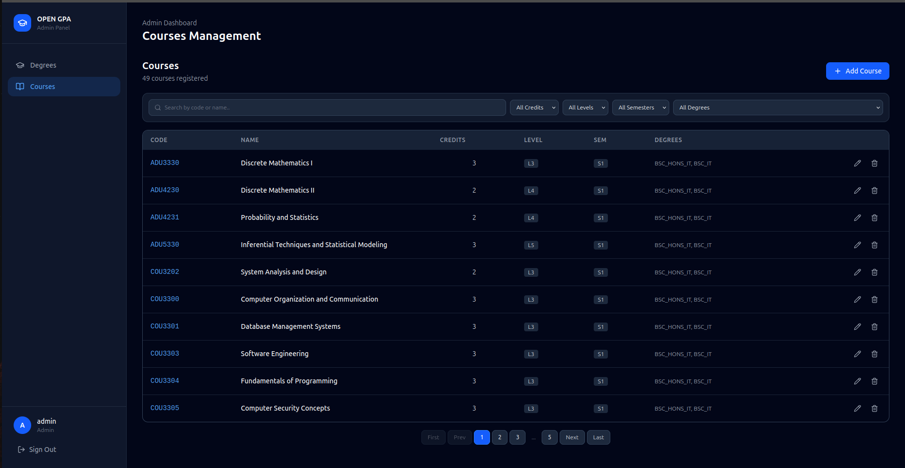
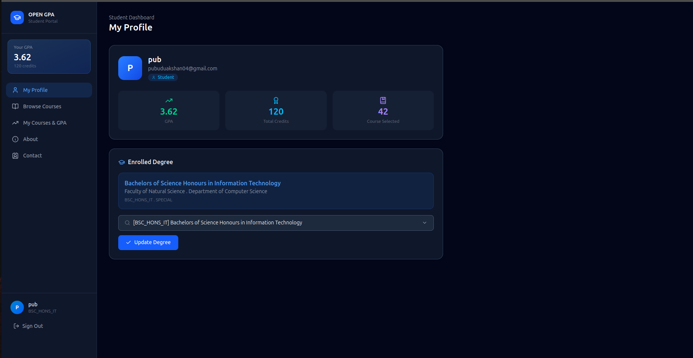

# OPEN GPA (GPA Calculator v2.0)

A full-stack GPA calculation and academic management platform built for the students of Open University of Sri Lanka.


🔗 **Live Demo:** https://open-gpa-gamma.vercel.app/

📦 **Repository:** https://github.com/Pubudu003/open_gpa/

## 📸 Screenshots

### Landing Page



### Sign Up 



### Sign In



### Forgot Password



### Admin Dashboard



### Student Dashboard



## ✨ Features

### 🔐 Authentication

- User registration
- Email verification
- Password reset

### 👤 Student

- Select degree
- Change degree
- Select courses
- Select grade
- View calculated GPA
- Manage courses
- Send feedback

### 👨‍💼 Admin

- Manage degrees
- Manage courses

## 🛠️ Tech Stack

### Frontend

- React
- Tailwind CSS
- Axios

### Backend

- Node.js
- Express.js

### Database

- MongoDB
- Mongoose

###  Authentication

- JWT
- bcrypt
- Nodemailer

### Development

- Git
- GitHub
- ESLint

## 🏗️ Architecture

## 📁 Project Structure

```text
project/
|--frontend/
|  |--assets/
|  |--public/
|  |--src/
|  |  |--components/
|  |  |--lib/
|  |  |--pages/
|  |  |--stores/
|--backend/
|  |  |--config/
|  |  |--controllers/
|  |  |--lib/
|  |  |--middleware/
|  |  |--models/
|  |  |--routes/
|  |  |--utils/
|--docs/
|--README.md
```
## 🗄️ Database

The application uses MongoDB

### Main Collections

- Users
- Degrees
- Courses
- Feedbacks

## 🔐 Security

- Passwords are hashed using bcrypt
- Authentication uses JWT
- Protected routes use authentication middleware
- Sensitive configuration is stored in environment variable
- User input is validated before processing

## 🧪 Testing

## 🚀 Deployment

### Frontend and Backend

Depolyed using Vercel

### Database

MongoDB Atlas

## 🗺️ Roadmap

- [x] User authentication
- [x] Email verification
- [x] Password reset
- [x] Degrees and Courses management 
- [x] GPA calculation
- [x] Admin and Student Dashboards
- [ ] Student grades insights
- [ ] AI assistant
- [ ] Download detailed report

## 📚 Lessons Learned

During development, I learned:

- How to design a REST API
- Implementing JWT authentication
- Working with MongoDB relationships
- Handling email verification
- Managing authentication middleware
- Deploying a full-stack application

## 🧠 Challenges & Solutions

### Email Verification

**Problem:** Verification emails were occasionally delayed.

**Solution:** Implemented a token-based verification system with
expiration and retry handling.

### Authentication

**Problem:** Protected routes needed consistent authentication.

**Solution:** Implemented reusable authentication middleware.

## 📄 License

This project is licensed under the MIT License.

## 👨‍💻 Author

**Pubudu**

BSc (Hons) in Computer Science

- GitHub: ...
- LinkedIn: ...
- Portfolio: ...
